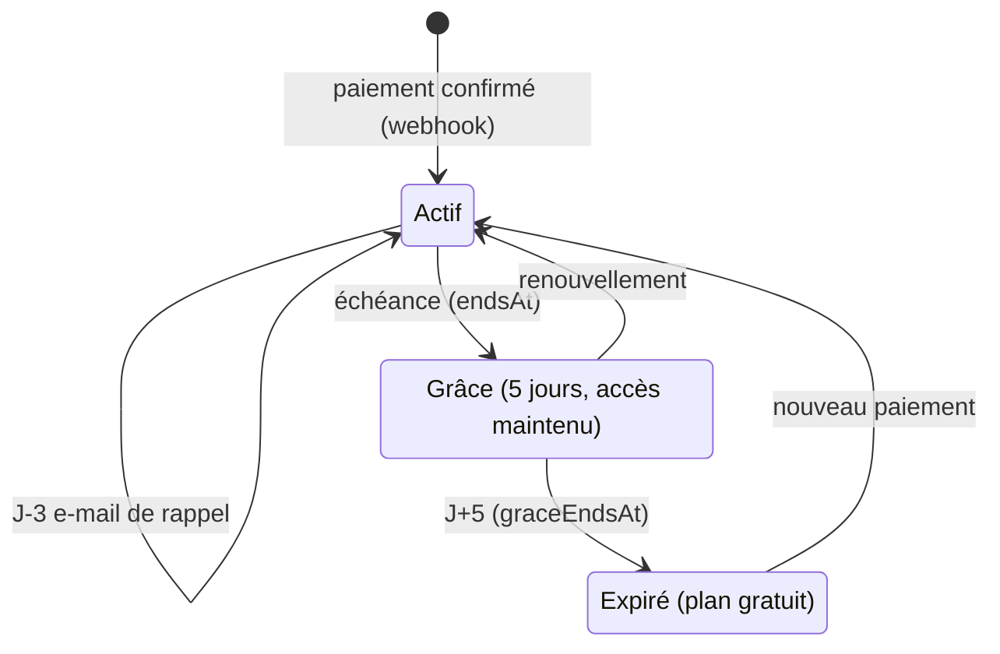
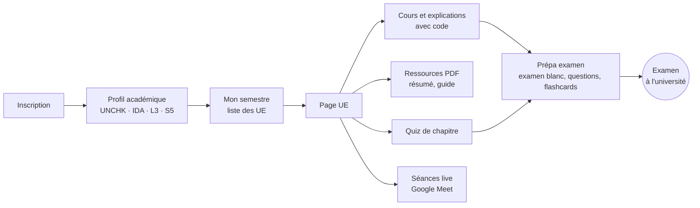
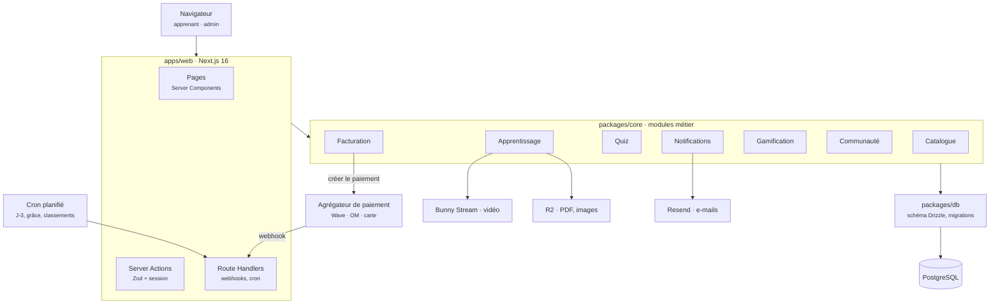
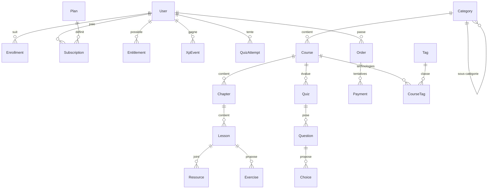
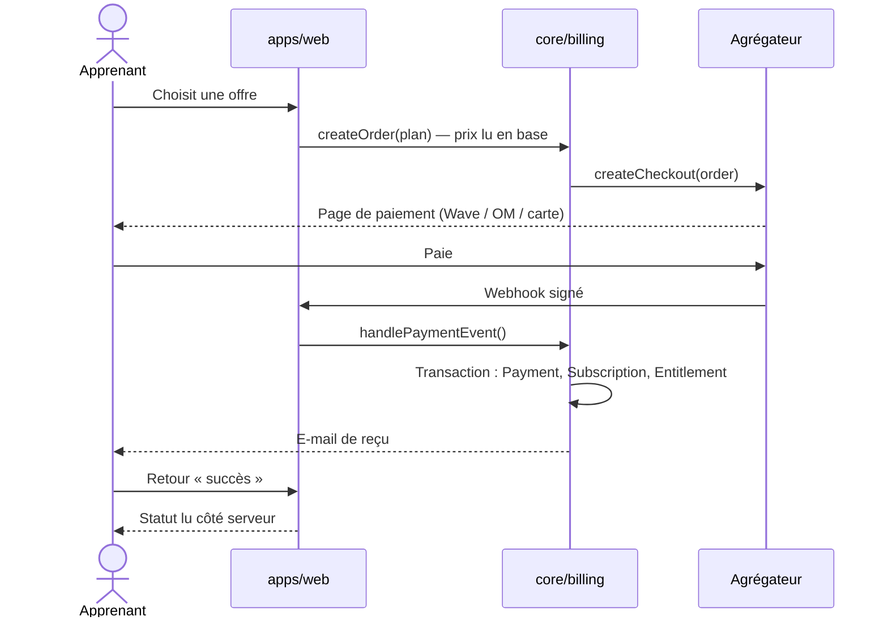

# Learnity V1 — Plan produit & architecture

> Dernière mise à jour : 20 novembre 2026 — cours tech, renforcement UNCHK, offres et maquette (29 écrans)
> Document de référence de l'équipe. Toute décision qui le contredit doit d'abord le mettre à jour.

## Sommaire

1. [En bref](#en-bref)
2. [Modèle économique et règles d'accès](#modèle-économique-et-règles-daccès)
3. [Périmètre fonctionnel V1](#périmètre-fonctionnel-v1)
4. [Renforcement universitaire (UNCHK)](#renforcement-universitaire-unchk)
5. [Plan du site](#plan-du-site)
6. [Stack technique](#stack-technique)
7. [Architecture applicative](#architecture-applicative)
8. [Modèle de données](#modèle-de-données)
9. [Paiements au Sénégal](#paiements-au-sénégal)
10. [Accès, gamification et notifications](#accès-gamification-et-notifications)
11. [Qualité, sécurité, performance, déploiement](#qualité-sécurité-performance-déploiement)
12. [Feuille de route](#feuille-de-route)
13. [Décisions](#décisions)
14. [Sources](#sources)

---

## En bref

Learnity V1 a deux univers : les **Formations**, une plateforme de formation en ligne **à la tech**, sur le modèle de Believemy et d'OpenClassrooms : développement web et mobile d'abord, puis IA, web design, e-commerce et tout ce qui touche à la tech. Les cours (vidéo, texte et PDF) sont créés uniquement par l'équipe Learnity, qui encaisse seule les revenus. Quiz corrigés, exercices pratiques, espace apprenant avec XP et classements, accès freemium + Premium (mensuel, annuel) + achat à vie d'un cours, payé en Wave, Orange Money ou Visa. Public : Sénégal d'abord, puis l'Afrique francophone. Et le **Renforcement**, qui accompagne les étudiants de l'UNCHK semestre par semestre, UE par UE (voir la section dédiée).

**Promesse proposée** : « Le déclic qui lance ta carrière tech. » (remplace « Le déclic avant l'examen », à valider).

**Domaines du catalogue**

| Domaine | Exemples de cours | Quand |
| --- | --- | --- |
| Développement web | HTML/CSS, JavaScript, React, Next.js, Node.js, PHP/Laravel | Lancement |
| Développement mobile | Flutter, React Native | Lancement |
| IA | Utiliser l'IA pour coder, prompts, automatisations | Après le lancement |
| Web design / UI-UX | Figma, design d'interface, design system | Après le lancement |
| E-commerce | Shopify, WooCommerce, vendre en ligne | Après le lancement |

Le catalogue est un arbre libre (domaine › technologie) : ajouter un domaine ne demande aucun développement.

Décisions d'architecture :

- **Un seul projet Next.js 16 (App Router, TypeScript strict)** dans un monorepo pnpm + Turborepo, découpé en *modules métier* (catalogue, apprentissage, quiz, facturation, gamification). Pas de microservices : à 4, c'est la complexité qui tue, pas la charge.
- **Back-end dans Next.js** (Server Actions + Route Handlers), base **PostgreSQL** via un ORM typé. Le choix Supabase ou autre se branche derrière une interface, sans réécrire le métier.
- **Paiement via un agrégateur sénégalais** (PayDunya ou équivalent) pour couvrir Wave, Orange Money, Free Money et carte en une intégration, derrière une interface `PaymentProvider`. L'agrégateur est choisi après le développement de la plateforme.
- **Abonnement prépayé** : le mobile money ne prélève pas automatiquement chaque mois, donc chaque période est un paiement que l'apprenant renouvelle, avec rappels.
- **Les droits d'accès sont calculés côté serveur** à partir d'une seule fonction `getAccess(user, lesson)` : jamais de vérification « premium » dans les composants.
- **Mono-éditeur** : seule l'équipe publie et encaisse (modèle Believemy). Un cours garde un `ownerId` (toujours l'équipe en V1) pour ne pas fermer la porte à des formateurs externes en V2 ou V3, sans rien construire de plus pour l'instant.

Hors périmètre V1 : formateurs externes et partage de revenus, application mobile native, boutique d'articles contre XP (on stocke les XP dès maintenant, l'échange vient après), forum public, connexion par téléphone, parcours métier et certificats (prévus plus tard).

---

## Modèle économique et règles d'accès

Côté Formations, trois façons d'accéder : gratuit (avec compte), Premium (tout le catalogue, mensuel ou annuel) et achat à vie d'un cours précis. Côté Renforcement, il n'y a pas d'offre gratuite : trois offres payantes, présentées uniquement sur la page Renforcement (voir la grille ci-dessous).

| Contenu | Visiteur | Gratuit | Achat à vie (ce cours) | Premium |
| --- | --- | --- | --- | --- |
| Fiche du cours, programme, avis | Oui | Oui | Oui | Oui |
| Cours au format texte | Aperçu (1re leçon) | Aperçu (3 premières leçons) | Complet | Complet |
| Cours vidéo | 1re vidéo | Aperçu (3 premières leçons) | Complet | Complet |
| Quiz et tests | Non | Non | Oui | Oui |
| Supports PDF à télécharger | Non | Non | Oui (ce cours) | Oui |
| XP, progression, classement | Non | Non | Oui | Oui |
| Poser une question sur une leçon | Non | Oui | Oui | Oui |

| Offre | Prix | Durée | Ouvre | Affichée sur |
| --- | --- | --- | --- | --- |
| Gratuit | 0 FCFA | — | Aperçus des formations | Accueil, `/premium` |
| Premium mensuel | 3 500 FCFA | 30 jours | Toutes les formations (`all_courses`) | Accueil, `/premium` |
| Premium annuel | 29 000 FCFA (2 417 FCFA par mois, −31 %) | 365 jours | Toutes les formations (`all_courses`) | Accueil, `/premium` |
| Pass Renforcement mensuel | 3 000 FCFA | 30 jours | Tout le renforcement (`reinforcement`) | `/renforcement` uniquement |
| Pass Renforcement annuel | 28 800 FCFA (2 400 FCFA par mois, −20 %) | 365 jours | Tout le renforcement (`reinforcement`) | `/renforcement` uniquement |
| Premium + Renforcement | 5 900 FCFA par mois (au lieu de 6 500) | 30 jours | Formations + renforcement | `/renforcement` uniquement |
| Achat à vie d'un cours | Fixé par cours (contenu, nombre d'heures) | Illimitée | Ce cours (`course`) | Fiche du cours |

Calcul du Pass annuel : 3 000 × 12 = 36 000 FCFA, moins 20 % = **28 800 FCFA**. L'offre Premium + Renforcement est mensuelle seulement, sans remise annuelle.

### Cycle de vie de l'abonnement

Prépayé, renouvelé par l'apprenant :

1. **Actif** : paiement confirmé par webhook, `endsAt = début + 30 ou 365 jours`.
2. **J‑3** : e-mail (et notification dans l'app) « ton Premium se termine dans 3 jours », avec un lien de renouvellement en un clic.
3. **Échéance** : passage en **grâce** pendant 5 jours, accès maintenu, bandeau de rappel, nouvel e-mail à J0.
4. **J+5** : passage en **expiré**, accès revenu au plan gratuit. Progression, XP et achats à vie conservés.
5. Un renouvellement pendant la grâce repart de l'ancienne date de fin, pour ne pas perdre de jours.
6. **Changer d'offre** (ex. Pass Renforcement → Premium + Renforcement) : en V1, la nouvelle offre démarre à l'échéance de l'actuelle, sans prorata ; l'admin peut ajuster à la main.

Le même cycle s'applique à toutes les offres (Premium, Pass Renforcement, Premium + Renforcement) ; les e-mails nomment l'offre concernée.



---

## Périmètre fonctionnel V1

44 fonctionnalités classées en **Indispensable** (le site ne sort pas sans), **Important** (dans la V1 si le planning tient) et **Plus tard**.

| Module | Fonctionnalité | Priorité |
| --- | --- | --- |
| Compte | Inscription / connexion e-mail + mot de passe, vérification e-mail | Indispensable |
| Compte | Connexion Google, mot de passe oublié | Indispensable |
| Compte | Connexion par numéro de téléphone (OTP SMS) | Plus tard |
| Compte | Profil : objectif (découvrir, reconversion, études, freelance), niveau, technologies suivies, avatar | Important |
| Compte | Question « Tu es étudiant ? » à l'inscription, qui ouvre le profil académique | Indispensable |
| Catalogue | Domaines et technologies (ex. Développement web › React) | Indispensable |
| Catalogue | Recherche et filtres (domaine, technologie, niveau, format, gratuit) | Indispensable |
| Catalogue | Page cours : objectifs, prérequis, programme, durée, aperçu, avis, prix | Indispensable |
| Apprentissage | Lecteur de cours : chapitres › leçons vidéo ou texte | Indispensable |
| Apprentissage | Progression par leçon, reprise où on s'est arrêté | Indispensable |
| Apprentissage | Avis et note sur un cours (après 30 % de progression) | Important |
| Apprentissage | Questions sur une leçon, réponses de l'équipe | Important |
| Apprentissage | Téléchargement des PDF et du code source (Premium ou achat) | Indispensable |
| Apprentissage | Leçons texte avec blocs de code colorés et bouton « Copier » | Indispensable |
| Apprentissage | Exercices pratiques : énoncé, indice, correction à dévoiler | Important |
| Quiz | Quiz de fin de chapitre (QCM, vrai/faux, questions sur du code) | Indispensable |
| Quiz | Correction expliquée, score, nouvelle tentative | Indispensable |
| Quiz | Test final du cours, chronométré | Important |
| Espace apprenant | Cours en cours, terminés, favoris | Indispensable |
| Espace apprenant | Historique des quiz et scores | Indispensable |
| Gamification | XP par leçon, quiz réussi et cours terminé | Important |
| Gamification | Classement par cours (hebdo et global) | Important |
| Gamification | Boutique d'articles Learnity contre XP | Plus tard |
| Paiement | Premium mensuel et annuel, Pass Renforcement mensuel et annuel, Premium + Renforcement (Wave, Orange Money, carte) | Indispensable |
| Paiement | Achat à vie d'un cours | Indispensable |
| Paiement | Tunnel adapté à l'univers : offres Premium depuis `/premium`, offres Renforcement depuis `/renforcement` | Indispensable |
| Paiement | Reçus et historique de paiement | Indispensable |
| Paiement | Codes promo | Plus tard |
| Notifications | E-mails transactionnels : bienvenue, paiement, J‑3, expiration | Indispensable |
| Admin | Tableau de bord : inscrits, revenus, abonnés actifs | Indispensable |
| Admin | CRUD cours, chapitres, leçons, quiz, catégories | Indispensable |
| Admin | Upload vidéos et PDF | Indispensable |
| Admin | Gestion des utilisateurs et des abonnements (prolonger, rembourser) | Indispensable |
| Admin | Modération des avis et questions | Important |
| Site | Pages publiques, SEO, blog | Important |
| Plus tard | Parcours métier (ex. « Développeur front-end »), certificats de réussite, projets fil rouge | Plus tard |
| Renforcement | Profil académique : université (UNCHK par défaut), filière, niveau, semestre | Indispensable |
| Renforcement | Mon semestre : UE du semestre avec contenus et progression | Indispensable |
| Renforcement | Page UE : résumé, guide PDF, explications avec code, quiz | Indispensable |
| Renforcement | Prépa examen : examen blanc, questions à préparer, flashcards | Indispensable |
| Renforcement | Séances live Google Meet planifiées + replays | Important |
| Admin | Référentiel académique et contenus de renforcement par UE | Indispensable |
| Admin | Gestion des offres : prix, durée, accès ouvert, page d'affichage | Indispensable |
| Renforcement | Check-list « Prêt pour l'examen » par UE et bloc « Mon semestre » au tableau de bord | Important |
| V2 / V3 | Formateurs externes, vente de cours par des tiers, reversements | Plus tard |

---

## Renforcement universitaire (UNCHK)

Learnity a **deux univers** : les **Formations** (cours tech ouverts à tous, modèle Believemy / OpenClassrooms) et le **Renforcement** (accompagnement des étudiants de l'Université numérique Cheikh Hamidou Kane, calé sur leurs UE, semestre par semestre). Le renforcement reprend ce que l'équipe fait déjà en Google Meet avec sa promotion : suivre le rythme et le programme de chaque UE, mais avec des cours conçus par l'équipe (méthodes à jour, code à l'appui), puis préparer l'examen. Aucun cours officiel n'est recopié. C'est le différenciateur de Learnity.

| | Formations | Renforcement |
| --- | --- | --- |
| Pour qui | Tout le monde | Étudiants de l'UNCHK (autres universités plus tard) |
| Organisation | Domaine › technologie | Université › filière › niveau › semestre › UE |
| Contenu | Cours tech conçus par l'équipe | Cours, résumés et guides originaux calés sur le programme de l'UE, explications avec code, quiz, préparation à l'examen, séances live |
| Point d'entrée | `/formations` | `/renforcement` |

**Un seul moteur de cours.** Un cours de renforcement est un `Course` comme les autres (chapitres, leçons, quiz, ressources, `getAccess`), avec `kind = reinforcement` et un rattachement à une UE (`academicUnitId`). Tout l'éditeur, le lecteur, les quiz et les XP sont réutilisés : seuls le référentiel académique, la page « Mon semestre » et la préparation à l'examen sont nouveaux.

### Parcours de l'étudiant

1. **Profil académique** : université (UNCHK par défaut), filière, niveau (L1, L2, L3) et semestre. Le semestre dépend du niveau : L1 = S1–S2, L2 = S3–S4, L3 = S5 (le S6 est un projet noté, sans examen : pas de renforcement en V1). Filière au lancement : **Informatique, Développement d'Applications (IDA)**, la seule ouverte en V1 ; les autres (ex. Arts graphiques et numériques) seront ajoutées depuis l'admin, sans code. Demandé à l'inscription (« Tu es étudiant ? ») ou au premier clic sur Renforcement, modifiable à tout moment, avec un rappel à chaque changement de semestre.
2. **Mon semestre** : la liste des UE du semestre choisi, avec pour chacune la progression et ce qui est disponible (résumé, guide, quiz, prépa examen, prochaine séance live).
3. **Page UE** : onglets Cours · Ressources · Quiz · Prépa examen · Séances live.
4. **Prépa examen** : examen blanc chronométré, questions probables avec réponse modèle, flashcards, puis une check-list « prêt pour l'examen ».




### Contenu d'une UE

| Type | Ce que c'est | Format technique |
| --- | --- | --- |
| Résumé du cours | Synthèse originale des notions de l'UE, rédigée par l'équipe | Leçon texte + PDF téléchargeable |
| Guide complet | Version détaillée, avec exemples et schémas | Ressource PDF |
| Explications avec code | Les notions mal comprises, démontrées en code | Leçon texte (blocs de code) ou vidéo |
| Quiz de chapitre | Vérifier chaque partie du cours | `Quiz` kind `chapter` |
| Examen blanc | Sujet type, en temps limité, corrigé à la fin | `Quiz` kind `exam` |
| Questions à préparer | Questions probables à l'examen + réponse modèle | `PracticeQuestion` kind `open` |
| Flashcards | Définitions et notions clés à mémoriser | `PracticeQuestion` kind `flashcard` |
| Séances live | Séances Google Meet planifiées + replays | `LiveSession` |

### Nouvelles données

| Entité | Champs clés | Rôle |
| --- | --- | --- |
| `University` | name, shortName (`UNCHK`), isDefault | référentiel, extensible à d'autres universités |
| `Program` | universityId, name, slug | filière (gérée dans l'admin) |
| `Semester` | programId, level (1–3), number (1–6), label, hasExam | semestres d'une filière ; IDA : S1–S5 avec examen (S6 = projet, `hasExam = false`, non couvert en V1) |
| `AcademicUnit` | semesterId, code, name, description, academicYear, position | une UE du programme (ex. « Programmation orientée objet »), saisie par l'admin |
| `AcademicProfile` | userId, universityId, programId, semesterId, academicYear | où en est l'étudiant |
| `PracticeQuestion` | academicUnitId, kind (`open`, `flashcard`), question, modelAnswer, difficulty | questions à préparer et flashcards |
| `LiveSession` | academicUnitId, title, startsAt, meetUrl, recordingUrl, status | séances Google Meet et replays |

Changements sur l'existant : `Course.kind` (`training`, `reinforcement`), `Course.academicUnitId?`, `Quiz.kind` accepte `exam`, `Entitlement.scope` accepte `reinforcement`, `Plan` gagne `scopes` et `displayOn`.

### Accès et prix

Décidé (20/11) : le renforcement a ses propres offres, toutes payantes, affichées **uniquement en bas de la page `/renforcement`** (jamais sur l'accueil ni sur `/premium`) :

1. **Pass Renforcement mensuel** : 3 000 FCFA par mois.
2. **Pass Renforcement annuel** : 28 800 FCFA par an (3 000 × 12 = 36 000, −20 %), soit 2 400 FCFA par mois ; badge « Le plus avantageux ».
3. **Premium + Renforcement** : 5 900 FCFA par mois, mensuel uniquement ; toutes les formations tech en plus du renforcement (au lieu de 3 500 + 3 000 = 6 500).

Pas d'aperçu gratuit : la page de présentation, la liste des UE et le programme de chaque UE sont publics, tous les contenus exigent un droit `reinforcement`. Le Premium seul (formations) n'ouvre pas le renforcement. Le lien Meet d'une séance live n'est visible qu'avec un droit actif ; les replays suivent la règle des leçons.

### Back-office

Une section **Admin › Renforcement** : référentiel (universités, filières, semestres, UE, année académique ; l'équipe saisit elle-même la filière Informatique, Développement d'Applications (IDA) et ses UE de S1 à S5), contenus par UE (l'éditeur de cours existant), banque de questions d'examen et flashcards, planification des séances live (lien Meet, replay), et suivi (étudiants inscrits par semestre, UE les plus consultées).

### Points d'attention

- **Contenus originaux** : l'équipe suit le programme et le rythme de chaque UE mais rédige ses propres cours (méthodes parfois plus à jour) ; aucun PDF ni texte officiel n'est republié. Pas de démarche auprès de l'UNCHK prévue.
- **Nom de l'UNCHK** : garder une courte mention « Learnity est indépendant de l'UNCHK » pour qu'aucun étudiant ne pense à un service officiel.
- **Programmes qui changent** : chaque UE porte une `academicYear` pour garder l'historique d'une année à l'autre.

---

## Plan du site

32 routes réparties en quatre groupes de routes Next.js : `(marketing)` public et optimisé SEO, `(auth)`, `(app)` pour l'apprenant connecté, `admin` réservé à l'équipe.

| Route | Page | Accès |
| --- | --- | --- |
| `/` | Accueil | Public |
| `/cours` | Catalogue + filtres | Public |
| `/cours/[categorie]/[sous-categorie]` | Cours d'un domaine ou d'une technologie (ex. `/cours/developpement-web/react`) | Public |
| `/cours/[slug]` | Fiche cours : programme, aperçu, avis, prix | Public |
| `/formations` | Catalogue des formations tech (alias de `/cours`) | Public |
| `/renforcement` | Présentation du renforcement UNCHK, choix niveau / semestre, 3 offres, FAQ | Public |
| `/renforcement/mon-semestre` | UE du semestre de l'étudiant | Connecté |
| `/renforcement/[ue]` | Page UE : cours, ressources, quiz, prépa examen, séances live (programme public, contenus verrouillés sans droit) | Selon `getAccess` |
| `/renforcement/[ue]/examen` | Examen blanc, questions à préparer, flashcards, check-list | Droit `reinforcement` |
| `/premium` | Offres Gratuit et Premium (formations), comparatif, FAQ | Public |
| `/blog`, `/blog/[slug]` | Tutoriels et articles tech (SEO) | Public |
| `/a-propos`, `/contact`, `/cgu`, `/confidentialite` | Pages légales | Public |
| `/connexion`, `/inscription`, `/mot-de-passe-oublie`, `/verifier-email` | Authentification | Public |
| `/tableau-de-bord` | Accueil apprenant : reprendre, progression, XP, bloc « Mon semestre » | Connecté |
| `/apprendre/[slug]/[lecon]` | Lecteur de leçon vidéo ou texte | Selon `getAccess` |
| `/apprendre/[slug]/quiz/[quiz]` | Passage d'un quiz | Droit payant |
| `/mes-cours` | En cours, terminés, achetés, favoris | Connecté |
| `/classement` | Classements par cours | Droit payant |
| `/profil`, `/parametres` | Profil, objectif, niveau, profil académique, notifications | Connecté |
| `/abonnement` | Offre en cours, renouvellement, changement d'offre, achats à vie, reçus | Connecté |
| `/paiement/[commande]` | Choix du moyen de paiement, puis retour succès / échec | Connecté |
| `/admin` | Indicateurs | Admin |
| `/admin/cours`, `/admin/cours/[id]` | CRUD cours, éditeur de chapitres et leçons | Admin |
| `/admin/quiz` | Banque de questions, quiz | Admin |
| `/admin/categories` | Arbre des catégories | Admin |
| `/admin/apprenants` | Utilisateurs, abonnements, prolongations | Admin |
| `/admin/offres` | Offres : prix, durée, scopes, page d'affichage | Admin |
| `/admin/paiements` | Transactions, remboursements, rapprochement | Admin |
| `/admin/moderation` | Avis et questions à traiter | Admin |
| `/admin/renforcement` | Référentiel (universités, filières, semestres, UE), contenus par UE, questions d'examen, séances live | Admin |
| `/api/webhooks/[provider]` | Réception des confirmations de paiement | Serveur |
| `/api/cron/[job]` | Tâches planifiées (rappels J‑3, expirations, rappels de séance live) | Serveur |

### Écrans de la maquette

La maquette « Learnity — Maquette V1 » (29 écrans) fait référence. Correspondance écran → route :

| Écran | Route |
| --- | --- |
| Accueil (desktop, mobile) | `/` |
| Catalogue | `/cours`, `/formations` |
| Fiche cours | `/cours/[slug]` |
| Lecteur de leçon (desktop, mobile) | `/apprendre/[slug]/[lecon]` |
| Quiz | `/apprendre/[slug]/quiz/[quiz]` |
| Tableau de bord (desktop, mobile), Mes cours, Classement, Abonnement, Profil | `/tableau-de-bord`, `/mes-cours`, `/classement`, `/abonnement`, `/profil` |
| Inscription et connexion, Mot de passe | `/inscription`, `/connexion`, `/mot-de-passe-oublie`, `/verifier-email` |
| Paiement | `/paiement/[commande]` |
| Premium, Blog, Article, À propos et pages légales | `/premium`, `/blog`, `/blog/[slug]`, `/a-propos`… |
| Renforcement · présentation (desktop, mobile) | `/renforcement` |
| Renforcement · Mon semestre | `/renforcement/mon-semestre` |
| Renforcement · Page UE | `/renforcement/[ue]` |
| Renforcement · Prépa examen | `/renforcement/[ue]/examen` |
| Admin · Indicateurs, Éditeur de cours, Gestion (dont Offres), Renforcement | `/admin`, `/admin/cours/[id]`, `/admin/quiz` … `/admin/offres`, `/admin/renforcement` |

Les bascules « États de l'écran (démo) » de la maquette (Avec un Pass / Sans droit, Depuis Premium / Depuis Renforcement) montrent des états : en production, l'état vient du serveur.

---

## Stack technique

Une stack 100 % TypeScript, choisie pour qu'une équipe de 4 qui maîtrise les bases soit guidée par les types et les outils plutôt que par la mémoire. Next.js 16 est la version stable actuelle (16.4.1 en octobre 2026).

| Besoin | Choix | Pourquoi |
| --- | --- | --- |
| Framework | Next.js 16, App Router, React 19, TypeScript `strict` | Rendu serveur pour le SEO du catalogue, Server Actions pour les formulaires, un seul déploiement |
| Monorepo | pnpm + Turborepo | Sépare l'app, l'UI et le métier ; prêt pour une app admin ou mobile séparée en V2 |
| UI | Tailwind CSS 4 + shadcn/ui, thémé avec les tokens de la charte | Composants accessibles que l'on possède dans le code, pas une dépendance figée |
| Validation | Zod | Un seul schéma valide formulaires, Server Actions, webhooks et variables d'environnement |
| Base de données | PostgreSQL | Relations fortes (cours, progression, paiements), transactions pour les paiements ; compatible Supabase, Neon ou un VPS |
| ORM | Drizzle ORM + drizzle-kit (migrations) | Typé, proche du SQL, léger ; fonctionne sur n'importe quel Postgres, Supabase compris |
| Auth | Better Auth (ou Supabase Auth si Supabase est retenu) | Sessions côté serveur, Google, vérification e-mail, rôles ; données dans votre base |
| Vidéo | Bunny Stream (ou Mux) | Streaming adaptatif HLS pour les connexions mobiles lentes, URLs signées contre le partage de liens |
| Fichiers | Stockage S3 compatible (Cloudflare R2) | PDF et images servis par URL signée à durée courte |
| Leçons texte | Contenu riche stocké en JSON, éditeur Tiptap dans l'admin | Format OpenClassrooms : titres, code, formules, images, encadrés |
| E-mails | Resend + React Email | Modèles d'e-mails en composants React, aux couleurs de la charte |
| Tâches planifiées | Cron (Vercel Cron) + jobs idempotents ; Inngest si besoin de files d'attente | Rappels J‑3, expirations, recalcul des classements |
| Paiement | Agrégateur (PayDunya ou CinetPay) derrière une interface ; `FakePaymentProvider` en développement | Une intégration pour Wave, Orange Money, Free Money et carte |
| Qualité | ESLint, Prettier, Vitest, Playwright, Husky + lint-staged | Les erreurs sont bloquées avant le commit et en CI |
| Suivi | Sentry (erreurs), PostHog (usage, entonnoir d'achat) | Savoir où les apprenants décrochent |
| Hébergement | Vercel (prévisualisation par branche) ; Docker possible plus tard | Déploiement à chaque merge, une URL de test par pull request |

---

## Architecture applicative

Un « monolithe modulaire » : une seule application déployée, mais le métier est rangé en modules isolés dans `packages/core`, qui ne dépendent ni de React ni de Next.js. Chaque module peut devenir un service séparé le jour où la charge l'exige, sans réécriture.



Les pages et actions appellent `core` ; seul `core` parle à la base et aux services externes ; l'agrégateur et le cron entrent par les Route Handlers.

### Structure du dépôt

```text
learnity/
├─ apps/
│  └─ web/                         Next.js 16
│     └─ src/
│        ├─ app/
│        │  ├─ (marketing)/          accueil, formations, renforcement, premium, blog
│        │  ├─ (auth)/               connexion, inscription
│        │  ├─ (app)/                tableau-de-bord, apprendre, mes-cours, renforcement/mon-semestre, [ue], [ue]/examen
│        │  ├─ admin/                back-office (dont offres et renforcement)
│        │  └─ api/
│        │     ├─ webhooks/[provider]/route.ts
│        │     └─ cron/[job]/route.ts
│        ├─ features/                UI par module : course-player, quiz-runner, exam-prep, academic-picker, checkout
│        ├─ actions/                 Server Actions (fines : valider, appeler core)
│        └─ lib/                     auth, env, utilitaires
├─ packages/
│  ├─ core/                         métier pur, un dossier par module
│  │  └─ src/
│  │     ├─ catalog/                cours, catégories, recherche
│  │     ├─ academic/               universités, filières, semestres, UE, profil académique, séances live
│  │     ├─ examprep/               examens blancs, questions à préparer, flashcards
│  │     ├─ learning/               progression, getAccess()
│  │     ├─ quiz/                   tentatives, correction
│  │     ├─ billing/                offres, commandes, abonnements, providers/
│  │     ├─ gamification/           XP, classements
│  │     ├─ community/              avis, questions
│  │     └─ notifications/          e-mails, notifications in-app
│  ├─ db/                           schéma Drizzle, migrations, seed
│  ├─ ui/                           design system Learnity (tokens + composants)
│  ├─ emails/                       modèles React Email
│  └─ config/                       tsconfig, eslint, preset Tailwind partagés
├─ docs/                            ce document, ADR, charte graphique
├─ turbo.json
└─ pnpm-workspace.yaml
```

Chaque module de `core` suit le même gabarit : `schemas.ts` (Zod), `service.ts` (cas d'usage), `repository.ts` (seul fichier qui parle à la base), `policies.ts` (qui a le droit), `events.ts`, et ses tests.

### Règles d'équipe

1. Les dépendances vont dans un seul sens : `app` → `core` → `db`. Un composant n'importe jamais `db`.
2. Server Components par défaut ; `"use client"` seulement pour le lecteur vidéo, le quiz, les formulaires interactifs.
3. Toute écriture passe par une Server Action qui valide avec Zod, vérifie la session, puis appelle un service.
4. Les modules communiquent par événements (`lesson.completed`, `quiz.passed`, `payment.succeeded`) : la gamification écoute, l'apprentissage ne connaît pas les XP.
5. Code et base de données en anglais, URLs et textes en français ; textes de l'interface regroupés dans des fichiers de messages pour ajouter l'anglais ou le wolof plus tard.
6. Variables d'environnement validées au démarrage ; secrets jamais côté client.
7. Une branche par tâche, pull request relue par une autre personne, commits conventionnels (`feat:`, `fix:`).

---

## Modèle de données

35 tables métier PostgreSQL (dont 7 pour le renforcement, détaillées dans sa section), plus celles de l'authentification. Trois choix structurants : le contenu est un arbre `Course › Chapter › Lesson`, l'accès est accordé par des **droits** (`Entitlement`) plutôt que déduit au cas par cas, et chaque mouvement d'XP est une ligne d'historique.

| Entité | Champs clés | Relations |
| --- | --- | --- |
| `User` | email, name, role (`student`, `admin`), goal (`discover`, `career_change`, `studies`, `freelance`), level, xpTotal | a des Enrollment, Subscription, Entitlement |
| `Category` | name, slug, parentId, color, icon, position | arbre libre : domaine › technologie |
| `Tag` / `CourseTag` | name, slug (ex. `react`, `typescript`) / courseId, tagId | technologies transverses, filtres et SEO |
| `Course` | kind (`training`, `reinforcement`), academicUnitId?, title, slug, ownerId, categoryId?, format (`video`, `text`, `mixed`), level (`beginner`, `intermediate`, `advanced`), prerequisites, objectives, estimatedMinutes, status (`draft`, `published`), lifetimePrice | a des Chapter ; ownerId = l'équipe en V1 |
| `Chapter` | courseId, title, position | a des Lesson et un Quiz de fin |
| `Lesson` | chapterId, type (`video`, `text`), previewRank (1 = visible sans compte, 2–3 = avec compte gratuit), videoAssetId, content (JSON), durationSec, xpReward | a des Resource |
| `Resource` | lessonId ou courseId, kind (`pdf`, `source_code`, `link`), storageKey, isPremium | PDF, code source zippé, liens |
| `Exercise` | lessonId, statement, hint, solution (JSON riche) | exercice pratique, correction dévoilée à la demande |
| `Quiz` | courseId, chapterId?, kind (`chapter`, `final`, `exam`), passScore, timeLimitSec, xpReward | a des Question |
| `Question` / `Choice` | prompt (peut contenir du code), explanation, type (`single`, `multiple`, `true_false`) / label, isCorrect | banque de questions réutilisable |
| `QuizAttempt` / `AttemptAnswer` | userId, quizId, score, passed, startedAt, submittedAt | historique complet des réponses |
| `Enrollment` | userId, courseId, status, progressPct, lastLessonId, completedAt | « mes cours » |
| `LessonProgress` | userId, lessonId, completed, positionSec | reprise vidéo |
| `Review` | userId, courseId, rating 1–5, comment, status | un avis par apprenant et par cours |
| `LessonQuestion` / `Answer` | userId, lessonId, body, status | questions-réponses |
| `Plan` | code (`premium_monthly`, `premium_yearly`, `reinforcement_monthly`, `reinforcement_yearly`, `bundle_monthly`), price, durationDays, scopes (`all_courses`, `reinforcement`), displayOn (`home`, `reinforcement`), active | offres modifiables sans déploiement ; un paiement accorde un `Entitlement` par scope de l'offre |
| `Order` | userId, type (`subscription`, `course`), planId? ou courseId?, amount, currency `XOF`, status | ce que l'apprenant achète |
| `Payment` | orderId, provider, method (`wave`, `orange_money`, `card`), providerRef, status, rawPayload | une tentative de paiement ; idempotence sur providerRef |
| `Subscription` | userId, planId, status (`active`, `grace`, `expired`, `canceled`), startsAt, endsAt, graceEndsAt | une ligne par période payée |
| `Entitlement` | userId, scope (`all_courses`, `course`, `reinforcement`), courseId?, source (`subscription`, `purchase`, `admin`), startsAt, endsAt? | **la seule chose que `getAccess` lit** |
| `XpEvent` | userId, amount, reason (`lesson_completed`, `quiz_passed`, `course_completed`), refId, courseId | unique (userId, reason, refId) : pas de double gain |
| `Notification` / `EmailLog` | userId, type, sentAt | évite d'envoyer deux fois le rappel J‑3 |
| `AuditLog` | actorId, action, target, data | trace des actions admin (prolongation, remboursement) |

Montants en entiers (le FCFA n'a pas de centimes). Dates en UTC, affichées en heure de Dakar (UTC+0). Suppression logique (`deletedAt`) sur les cours et les utilisateurs.



---

## Paiements au Sénégal

Recommandation : un agrégateur local, caché derrière une interface `PaymentProvider`, puis Wave en direct quand le volume justifie l'intégration en plus. **Décision : l'agrégateur est choisi après le développement de la plateforme ; le paiement réel s'intègre en dernier.**

| Option | Couvre | Frais indicatifs | Pour Learnity |
| --- | --- | --- | --- |
| PayDunya (agrégateur sénégalais) | Wave, Orange Money, Free Money, Visa/Mastercard | autour de 2,5 % + 100 FCFA | Une seule intégration pour tout |
| CinetPay (agrégateur régional) | Visa/Mastercard, Orange Money, Wave, Free Money | à demander | Alternative |
| API Wave Checkout (direct) | Wave uniquement | autour de 1 % | Plus tard : moins de frais sur le moyen le plus utilisé |

Frais tirés d'articles d'intégrateurs sénégalais : à confirmer par devis. Stripe ne sert pas les marchands sénégalais. L'API Wave fonctionne par sessions de paiement (création, consultation, expiration, remboursement) et signe ses requêtes en HMAC-SHA256.

**Abonnement sans prélèvement automatique.** Wave et Orange Money ne débitent pas un compte chaque mois sans action de l'utilisateur. On vend donc des **périodes prépayées** (30 ou 365 jours) que l'apprenant renouvelle en un clic depuis l'e-mail J‑3. Le prélèvement automatique par carte pourra s'ajouter si l'agrégateur le propose.

### Règles qui évitent les erreurs d'argent

1. Le prix est toujours lu en base côté serveur, jamais envoyé par le navigateur.
2. **Seul le webhook fait foi.** La page de retour « succès » affiche « confirmation en cours » et attend le statut serveur.
3. Signature du webhook vérifiée, puis traitement idempotent : un `providerRef` déjà traité est ignoré.
4. Paiement confirmé → dans **une transaction** : `Payment` réussi, `Subscription` ou achat créé, `Entitlement` accordé, événement `payment.succeeded`.
5. Un job de rapprochement interroge toutes les 15 minutes les paiements restés « en attente » (webhook perdu).
6. Chaque webhook reçu est stocké brut (`rawPayload`) pour les litiges.



```ts
// packages/core/src/billing/providers/payment-provider.ts
export interface PaymentProvider {
  createCheckout(input: {
    orderId: string;
    amount: number;           // FCFA, entier
    currency: "XOF";
    customer: { name: string; email: string; phone?: string };
    successUrl: string;
    errorUrl: string;
  }): Promise<{ checkoutUrl: string; providerRef: string }>;
  parseWebhook(request: Request): Promise<PaymentEvent>; // vérifie la signature
  getStatus(providerRef: string): Promise<"pending" | "succeeded" | "failed" | "expired">;
}
```

### Développer sans agrégateur

Un `FakePaymentProvider` implémente l'interface `PaymentProvider` dès le sprint 4. Il simule un paiement réussi, échoué ou expiré et envoie un faux webhook, ce qui permet de construire et tester abonnements, droits d'accès, rappels J‑3 et grâce. Brancher l'agrégateur choisi revient ensuite à écrire une seule classe. Lancer le dossier marchand (registre du commerce, NINEA, compte bancaire UEMOA) quelques semaines avant la mise en ligne.

---

## Accès, gamification et notifications

### Une seule source de vérité pour l'accès

Toute page ou API qui sert du contenu payant appelle `getAccess`, côté serveur. Le lecteur vidéo ne reçoit une URL signée (valable quelques minutes) que si l'accès est accordé ; un PDF, pareil.

```ts
// packages/core/src/learning/access.ts
export async function getAccess(userId: string | null, lesson: Lesson): Promise<Access> {
  // Aperçu (formations seulement) : 1re leçon sans compte, 3 premières avec un compte gratuit
  const course = await courses.get(lesson.courseId);
  const previewLimit = course.kind === "reinforcement" ? 0 : userId ? 3 : 1;
  if (lesson.previewRank && lesson.previewRank <= previewLimit) {
    return { granted: true, reason: "preview" };
  }
  if (!userId) return { granted: false, reason: "login_required" };
  // formation : all_courses ou course ; renforcement : reinforcement (pas d'aperçu gratuit)
  const ent = await entitlements.findActive(userId, lesson.courseId, course.kind);
  return ent
    ? { granted: true, reason: ent.source }
    : { granted: false, reason: course.kind === "reinforcement" ? "reinforcement_required" : "premium_required" }; // l'UI affiche les bonnes offres
}
// Quiz, PDF, XP et classement : même règle, un droit actif (Premium ou achat du cours) est requis.
```

Le statut Premium affiché sur le profil vient du même calcul : un abonnement en `grace` reste un droit actif jusqu'à `graceEndsAt`. Les rôles (`admin`, `student`) sont vérifiés dans le layout `admin/` et dans chaque Server Action d'administration.

### XP et classements

| Action | XP proposés |
| --- | --- |
| Leçon terminée | 10 |
| Quiz de chapitre réussi (1re réussite) | 50 |
| Score parfait à un quiz | +20 |
| Cours terminé | 200 |
| Test final réussi | 100 |
| Exercice pratique terminé | 20 |

Valeurs à ajuster ; elles vivent en base (`Lesson.xpReward`, `Quiz.xpReward`) et non dans le code. Chaque gain est un `XpEvent` unique par (apprenant, raison, objet) : refaire un quiz ne rapporte pas deux fois. Le classement d'un cours = somme des `XpEvent` de ce cours, sur la semaine ou depuis le début, recalculée par un job toutes les 10 minutes dans une table `LeaderboardEntry`. Le solde d'XP est conservé pour la future boutique. Les XP et le classement sont réservés aux apprenants Premium ou ayant acheté le cours.

### Notifications

| Déclencheur | Canal | Contenu |
| --- | --- | --- |
| Inscription | E-mail | Bienvenue + vérification e-mail |
| Paiement confirmé | E-mail | Reçu, dates de l'abonnement |
| Paiement échoué ou expiré | E-mail | Lien pour réessayer |
| Abonnement J‑3 | E-mail + in-app | Rappel + bouton « Renouveler » |
| Échéance (début de grâce) | E-mail + bandeau | 5 jours pour renouveler sans perte |
| Fin de grâce | E-mail | Retour au plan gratuit, progression conservée |
| Réponse à une question | In-app + e-mail | Lien vers la leçon |

Le job quotidien (8 h, heure de Dakar) traite J‑3, début de grâce et fin de grâce ; `EmailLog` empêche tout double envoi si le job tourne deux fois.

---

## Qualité, sécurité, performance, déploiement

| Domaine | Ce qu'on met en place dès le sprint 0 |
| --- | --- |
| Tests | Vitest sur `core` (accès dont scopes `reinforcement` et offre combinée, affichage des offres selon `displayOn`, abonnements, XP, webhooks : obligatoires) ; Playwright sur 4 parcours : inscription (avec profil académique), suivre une leçon, payer, Pass Renforcement → page UE → examen blanc corrigé après envoi |
| CI | GitHub Actions à chaque pull request : typecheck, lint, tests, build ; merge bloqué si rouge |
| Environnements | `local` (Postgres Docker), `preview` (une URL par pull request), `production` ; bases séparées, clés de paiement de test hors production |
| Sécurité | Sessions httpOnly, CSRF géré par les Server Actions, limitation de débit sur connexion et webhooks, en-têtes CSP, URLs signées pour vidéos et PDF, journal d'audit admin |
| Données personnelles | Consentement à l'inscription, export et suppression de compte ; déclaration auprès de la CDP (Sénégal) à prévoir |
| Performance mobile | Pages catalogue statiques revalidées, images `next/image`, vidéo adaptative (qualité basse par défaut en 3G), budget : moins de 200 Ko de JS sur la page d'accueil |
| SEO | Métadonnées par cours, sitemap, données structurées `Course`, URLs en français, blog de tutoriels tech |
| Accessibilité | Contrastes AA de la charte, navigation clavier dans le quiz, sous-titres sur les vidéos |
| Observabilité | Sentry (erreurs), journaux des webhooks, alerte si un paiement reste « en attente » plus d'une heure |
| Sauvegardes | Sauvegarde quotidienne de la base, restauration testée une fois par mois |

---

## Feuille de route

Environ 15 semaines pour une équipe de 4, en sprints de deux semaines, si les cours sont produits en parallèle par l'équipe contenu.

| Semaines | Sprint | Contenu |
| --- | --- | --- |
| S1–2 | Sprint 0 · Fondations | Monorepo, CI, design system dans `packages/ui`, schéma de base, authentification |
| S3–4 | Sprint 1 · Catalogue et admin | Domaines et technologies, CRUD cours, chapitres et leçons, upload vidéo et PDF, pages publiques |
| S5–6 | Sprint 2 · Apprentissage | Lecteur vidéo et texte, progression, `getAccess`, Mes cours, tableau de bord |
| S7–8 | Sprint 3 · Quiz et XP | Quiz, test final, exercices pratiques, correction expliquée, XP, classements par cours |
| S9–10 | Sprint 4 · Renforcement UNCHK | Référentiel académique, profil étudiant, Mon semestre, page UE, prépa examen, séances live, admin renforcement |
| S11–12 | Sprint 5 · Paiement et abonnements | Offres, paiement simulé, droits d'accès, rappels J‑3 et grâce ; agrégateur réel branché en fin |
| ◆ | Validation | Agrégateur choisi et un vrai paiement Wave, OM et carte traité de bout en bout |
| S13–14 | Sprint 6 · Finitions et bêta | Avis, questions, SEO et blog, tests de bout en bout, bêta fermée avec des apprenants et la promotion UNCHK |
| ◆ | Validation | Bêta sans bug bloquant sur inscription, leçon, quiz et paiement |
| S15 | **Lancement public de Learnity V1** | Catalogue de départ en ligne, Premium ouvert, suivi des premières conversions |

| Personne | Responsabilité principale |
| --- | --- |
| [Membre 1] | Architecture, `core`, paiements et abonnements, revue de code |
| [Membre 2] | Design system `packages/ui`, pages publiques, lecteur de cours |
| [Membre 3] | Base de données, back-office admin, quiz |
| [Membre 4] | Espace apprenant, XP et classements, tests E2E, mise en ligne des contenus |

**Formateurs externes (V2 ou V3, pas décidé)** : en V1, l'équipe est le seul éditeur et le seul bénéficiaire. On garde seulement `Course.ownerId` et des politiques « propriétaire du cours ou admin ». Le jour où l'on ouvre aux formateurs, on ajoutera le rôle `instructor`, l'espace formateur, une table de partage des revenus et les reversements.

---

## Décisions

Validées par l'équipe le 16 novembre 2026.

| Sujet | Décision |
| --- | --- |
| Positionnement | Cours tech uniquement (web, mobile, puis IA, design, e-commerce), créés et vendus par l'équipe seule, modèle Believemy / OpenClassrooms. Bac, BEFEM et Licence abandonnés |
| Promesse | « Le déclic qui lance ta carrière tech. » (proposition à valider) |
| Deux univers (20/11) | Formations tech + Renforcement UNCHK (niveau, semestre, UE, prépa examen), sur un seul moteur de cours |
| Accès au renforcement (20/11) | Offres dédiées, affichées seulement sur `/renforcement` : Pass mensuel 3 000 FCFA, Pass annuel 28 800 FCFA (−20 %), Premium + Renforcement 5 900 FCFA par mois. Pas d'offre gratuite ni d'aperçu |
| Filière au lancement (20/11) | Informatique, Développement d'Applications (IDA) uniquement, S1 à S5 (S6 = projet noté, non couvert) ; autres filières ajoutées plus tard depuis l'admin |
| Relation avec l'UNCHK (20/11) | Pas de prise de contact : contenus originaux calés sur le programme, mention d'indépendance conservée |
| Règle des 5 jours | 5 jours de grâce après l'échéance, accès maintenu, puis retour au plan gratuit |
| Contenu gratuit | Texte, vidéo et PDF : 1re leçon sans compte, 3 premières leçons avec un compte gratuit ; quiz, PDF, XP et classement réservés aux droits payants |
| Achat à vie | Inclut les PDF du cours |
| Prix Premium (20/11) | Formations seules : 3 500 FCFA par mois, 29 000 FCFA par an (grille initiale conservée) |
| Prix d'un cours à l'unité | Fixé cours par cours selon le contenu et le nombre d'heures, saisi par l'admin à la création (`Course.lifetimePrice`) |
| Agrégateur de paiement | Choisi après le développement de la plateforme ; le paiement réel s'intègre en dernier |
| Base et auth | L'architecture reste compatible Supabase ou Postgres + Better Auth, choix au sprint 0 |
| Hébergeur vidéo | Bunny Stream ou Mux, choix après un test de lecture en 3G avant le sprint 1 |
| Connexion par téléphone | Pas en V1, prévue plus tard |

Plus aucun point bloquant pour démarrer le sprint 0.

---

## Sources

- [Versions de Next.js](https://www.versio.io/de/product-release-end-of-life-eol-vercel-nextjs.html) : 16.4.1, octobre 2026
- [Documentation API Wave Checkout](https://docs.wave.com/checkout)
- [PayDunya : moyens couverts et frais](https://kolonell.com/fr/blog/integrer-checkout-paydunya-boutique-woocommerce-dakar-2026)
- [Accepter les cartes au Sénégal : PayDunya, CinetPay](https://kolonell.com/fr/blog/stripe-senegal-accepter-cartes-bancaires-contournement-2026)
